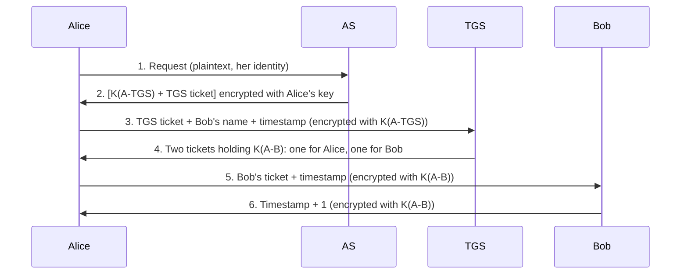

# Kerberos

> **Source:** `Module 4/4.1 Authentication_Kerberos.pptx`, slides 2–15 · **Syllabus:** Unit IV

## Key points

- In an open network a workstation cannot be trusted to identify its users, so **Kerberos uses a trusted third party** to verify identities.
- **NTLM** (older) uses challenge/response with a password hash; **Kerberos** (v5, its replacement) **never sends credentials, only tickets**.
- The **KDC** = **Authentication Server (AS)** + **Ticket-Granting Server (TGS)** + **Kerberos database**.
- The user logs in **once** with the AS, then asks the TGS for as many service tickets as needed.
- **Timestamps** prevent replay. Kerberos is for **client–server** use, **not person-to-person** authentication.

---

## 1. NTLM vs Kerberos

| | NTLM | Kerberos |
|---|---|---|
| Method | **Challenge/response** | **Tickets** |
| Steps | Client hashes the password and sends the username in plaintext; server replies with a **nonce** (challenge); client answers with it encrypted by the hash; server compares and logs the user in | Credentials are **never sent**, not even hashed |
| Weakness | Attackers can **capture or force** authentication | — |

## 2. Components

| Component | Role |
|---|---|
| **KDC** (Key Distribution Center) | The trusted third party; usually runs on the domain controller |
| **Authentication Server (AS)** | Does the initial login; issues the **TGT** (Ticket Granting Ticket) and a session key for the TGS. Can run on a read-only copy of the database, since it never modifies it |
| **Ticket-Granting Server (TGS)** | Issues **service tickets** (based on the TGT) and the session key between user and real server |
| **Kerberos database** | Holds every user's and service's **secret key** (password + salt, then encrypted) |
| **Real (data) server** | The service the user wants (e.g. FTP) |

Separating login (AS) from ticket issue (TGS) lets Alice verify her identity **once** and contact the TGS repeatedly.

## 3. Operation (Alice = user, Bob = real server)

1. Alice sends her identity to the AS in plaintext.
2. The AS replies with a message encrypted with **Alice's permanent key** containing the session key **K(A-TGS)** and a **TGS ticket** (encrypted with the AS–TGS key). Alice decrypts with her key.
3. Alice sends the TGS: the **ticket**, **Bob's name**, and a **timestamp encrypted with K(A-TGS)** (stops replay).
4. The TGS sends two tickets, each with the Alice–Bob session key **K(A-B)**: one encrypted for Alice (with K(A-TGS)), one for Bob (with K(TGS-B)).
5. Alice sends Bob his ticket plus a timestamp encrypted with K(A-B).
6. Bob confirms by returning **timestamp + 1**, encrypted with K(A-B).
