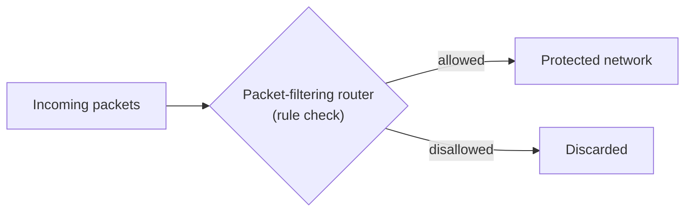

# Firewalls: Packet Filters and Application Gateways

> **Source:** `Module 5/5 Firewalls  Web Security.pdf`, pages 2–8 · **Syllabus:** Unit V

## Key points

- A **firewall** sits between a network and the outside; **all traffic must pass through it** to be allowed or blocked. It can be hardware, software or both.
- A **packet filter** checks each packet's **header** against rules. It is **fast** but sees little.
- An **application-level gateway** (proxy, "bastion host") checks **everything, including application data**. It is **most secure but slower**.

---

## 1. Packet filters

- Work at the **network layer** (also covers data link and transport fields), applying rules on **IP and transport header fields**: source/destination address and protocol type.
- Each packet is judged **in isolation**, with no memory of earlier traffic, so decisions are **very fast**.
- Each packet is **forwarded or discarded**.

*Example:* block all **UDP** segments and all **Telnet** connections, stopping outsiders logging into internal hosts and insiders logging into external ones.

## 2. Application gateways

- Also called **application proxies** or a **bastion host**; work at the **application layer**.
- Several gateways can run on one host, but **each is a separate server with its own processes**.
- Safest type, because it can examine **every layer, including application data**, and acts as both sides of the exchange.

*Example (FTP):* the proxy accepts **get** but rejects **put**, allows listing only certain files, or stops users leaving a directory.

**Operation:**

1. The user contacts the gateway with an application such as HTTP.
2. The gateway asks for the **remote host** and the user's **ID and password**.
3. After authenticating the user, the gateway **connects to the remote host on the user's behalf** and passes the packets.

## 3. Comparison

| | Packet filter | Application gateway |
|---|---|---|
| Complexity | Simplest | More complex |
| Screens by | **Connection rules** | **Behaviour / proxies** |
| Sees | Addresses and protocol type only | **Full data portion** of a packet |
| Auditing | Difficult | Activity can be audited |
| Performance impact | Low | High |
| Hides network topology | No | Yes |
| User transparency | Transparent | Not transparent |
